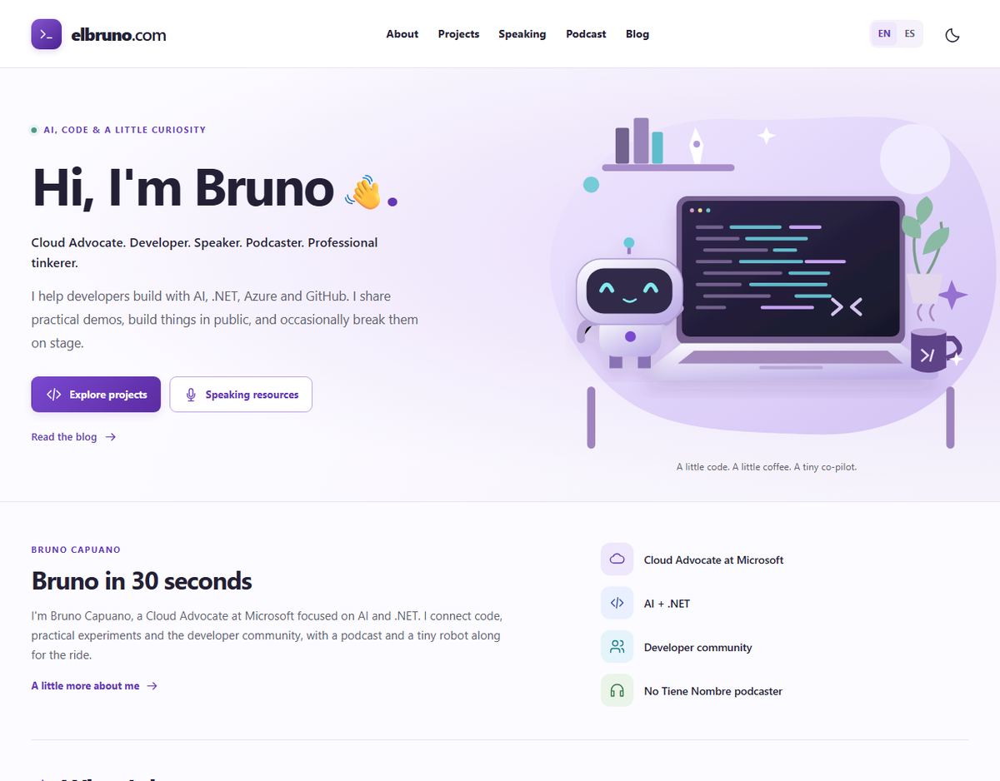

# elbruno.com

Bruno on the Internet: a bilingual, static personal website built with Astro and TypeScript. The approved visual direction is in `design-reference.png`; the product specification is `ELBRUNO_COM_PROJECT_SPEC.md`.



## Run locally

Use Node.js 22.23.4 or newer (Node 24 is used in CI).

```powershell
npm ci
npm run dev
```

Open the local address printed by Astro. No secrets or network access are required for ordinary builds. The committed content snapshot supplies external content.

```powershell
npm run validate
npm run build
npm run preview
npx playwright install chromium
npm run test:e2e
npm run format:check
```

`validate` runs Astro/TypeScript checks, ESLint, fixture/unit tests, snapshot validation and the production build. Playwright exercises desktop and mobile layouts, all eight content routes, both themes, clipboard controls, robot reactions, secret activation paths and game controls. Automated axe checks are not a replacement for human accessibility testing.

### Recorded local validation, November 4, 2026

The production build, type checks, lint, 13 fixture/unit tests and 18 Chromium desktop/mobile browser cases passed. Automated accessibility scans covered all eight content routes in light and dark themes. Overflow checks included 320, 390, 768, 1024 and 1440px widths. The production CSP was injected into browser responses to verify that interactions still work without external browser requests. An intentionally unavailable blog endpoint preserved the exact snapshot hash; repeated successful refreshes also left it unchanged.

Measured build output: shared site JavaScript 3,795 bytes (1,659 gzip), speaker controls 926 bytes (408 gzip), and the game 17,556 bytes (7,150 gzip), fetched only after activation. Shared CSS is 17,154 bytes (4,638 gzip). All shipped artwork together is 69,984 bytes. These are local byte measurements, not claimed Lighthouse scores or real-user timing data. Temporary-host TLS, actual Azure headers and live redirect behavior still need deployment QA.

## Project map

| Location                       | Purpose                                                          |
| ------------------------------ | ---------------------------------------------------------------- |
| `src\i18n\index.ts`            | Typed English/Spanish UI, route equivalents                      |
| `src\data\profile.ts`          | Verified profile, project selection and social links             |
| `src\data\speaking.ts`         | Six factual draft biographies, awaiting owner editorial approval |
| `src\data\feeds\snapshot.json` | Validated last-known-good public content                         |
| `src\components\`              | Shared semantic page and UI components                           |
| `src\styles\`                  | Light/dark design tokens and responsive styles                   |
| `src\lib\feeds\`               | XML normalization and runtime validation                         |
| `src\lib\game\`                | Lazy-loaded original arcade game and testable engine             |
| `public\assets\`               | Original vector artwork and raster social card                   |
| `tests\`                       | Fixture/unit tests and browser acceptance checks                 |

English routes are `/`, `/about/`, `/projects/`, `/speaking/`; Spanish equivalents use `/es/`. Translated pages share components rather than duplicated layouts. The language switch preserves the route. The site includes canonical URLs, language alternates, Person structured data, a sitemap and localized 404 content.

## Implementation milestones

| Phase | Result                                                                                                        |
| ----- | ------------------------------------------------------------------------------------------------------------- |
| A     | Astro foundation, bilingual homepage, responsive design system, themes and verified links                     |
| B     | About, Projects and Speaker Kit, six copyable draft biographies, honest photo/CV omissions                    |
| C     | Real blog/podcast/YouTube feeds, GitHub metadata, deterministic snapshots and refresh workflow                |
| D     | Four robot expressions, lazy-loaded Bug Invaders, keyboard/touch controls and a turn-based alternative        |
| E     | Local production build, browser/accessibility checks, CI, opt-in Azure preview deployment and migration guide |

**External gates still open:** Azure resource/token and preview URL validation; approved headshots, CV and event materials; owner review of bios; code/asset license approval; actual `t2i` generation when that skill is available. The career timeline, invented metrics and unverified contact details are deliberately absent.

## Content refresh

```powershell
npm run refresh-content
npm run validate-content
```

The refresh workflow runs every six hours and accepts manual dispatch. Failed sources preserve the previous snapshot. Only normalized changes are committed and redeployed. Optional `BLOG_RSS_URL` and `PODCAST_RSS_URL` process environment variables override the verified defaults. `.env.example` documents them; the standalone script does not automatically load `.env` files.

See [content sources](docs/content-sources.md) for provenance, fallback behavior and monitoring.

## Azure preview, not domain cutover

The deployment workflow is disabled until repository variable `AZURE_SWA_ENABLED` is `true`. Create an Azure Static Web App, configure `AZURE_STATIC_WEB_APPS_API_TOKEN` as a secret, and use the `preview` GitHub environment for review. Do not connect `elbruno.com` yet.

The workflow builds on Node 24, uploads `dist` with Azure's build step disabled, and adds preview-specific `noindex` headers and robots rules. A successful main-branch CI run triggers deployment. Manual dispatch is supported. Content refresh has its own conditional deployment because commits made with `GITHUB_TOKEN` do not start ordinary push workflows.

`public\staticwebapp.config.json` contains headers and real 404 behavior, not an SPA catch-all. The CSP permits same-origin scripts and assets only; inline CSS is allowed for presentation. There are no external embeds, analytics, browser-side API calls or forms. Theme choice is stored locally, and unavailable storage is handled. No cookies or leaderboard services are used.

No Azure deployment, domain binding, DNS change or WordPress migration has been performed. Follow [the migration guide](docs/domain-migration.md) before any cutover.

Implementation was checked against the current official [Astro installation guide](https://docs.astro.build/en/install-and-setup/), [Astro Azure deployment guide](https://docs.astro.build/en/guides/deploy/microsoft-azure/), and [Azure build configuration reference](https://learn.microsoft.com/en-us/azure/static-web-apps/build-configuration). Small Astro scripts are emitted as external files so the same-origin script CSP does not block speaker controls.

## Artwork and editorial safety

The skill loader reported that `t2i` was not installed, and inspected skill locations contained no `t2i` instructions. The specification's fallback was used: original SVG artwork with documented provenance, not generated portraits or stock photography. See [visual assets](docs/visual-assets.md).

The speaker kit explicitly labels biographies as drafts and photographs as pending. Unknown career history, a downloadable CV and private contact information are not fabricated. PromptDot is described using its real teleprompter identity.

## Contributing and licensing

See [CONTRIBUTING.md](CONTRIBUTING.md) and [speaker asset guidance](docs/speaker-assets.md).

**License selection is pending owner approval.** MIT is proposed for code, but no license has been granted by this change. Personal photos, supplied reference material and external publication content must be treated separately. Do not assume that a publicly visible repository grants reuse rights for those materials.
