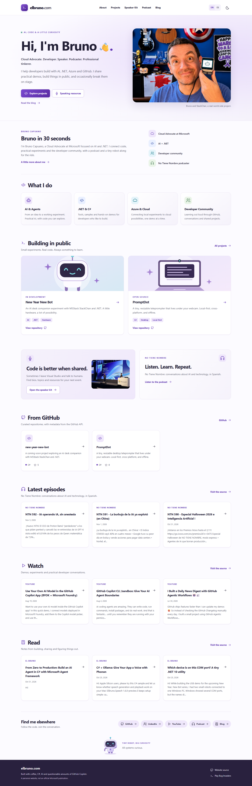

# elbruno.com

Bruno on the Internet: a bilingual, static personal website built with Astro and TypeScript. The approved visual direction is in `design-reference.png`; the product specification is `ELBRUNO_COM_PROJECT_SPEC.md`.



## Run locally

Use Node.js 22.23.4 or newer (Node 24 is used in CI).

```powershell
npm ci
npm run dev
```

Open the local address printed by Astro. No secrets or network access are required for ordinary builds. The committed content snapshot supplies external content.

```powershell
npm run validate
npm run build
npm run preview
npm run build-speaker-kit
npx playwright install chromium
npm run test:e2e
npm run format:check
```

`validate` runs Astro/TypeScript checks, ESLint, fixture/unit tests, snapshot validation and the production build. Playwright exercises desktop and mobile layouts, all eight content routes, both themes, clipboard controls, robot reactions, secret activation paths and game controls. Automated axe checks are not a replacement for human accessibility testing.

### v0.2 baseline validation, November 4, 2026

`npm run validate` passes Astro checks, ESLint, 14 unit tests, content validation and the static build. `npm run test:e2e` passes 22 Chromium desktop/mobile cases. Automated accessibility scans cover all eight localized routes in both themes. Browser checks cover 320, 390, 768, 1024 and 1440px layouts, existing robot/game behaviors, and the three English and Spanish photo downloads plus complete ZIP. Full-page EN/ES captures for Home, About and Speaker Kit, plus 390px mobile home captures, are in `docs/screenshots/`. The three high-quality photo downloads are 1.6 MiB, 1.7 MiB and 1.8 MiB; the six-file ZIP is 5,343,151 bytes. These are local measurements, not Lighthouse scores or real-user timing data. Temporary-host TLS, actual Azure headers and live redirect behavior still need deployment QA.

### v0.3 launch-readiness verification

`npm run validate` passes Astro checks, ESLint, 16 unit tests, content validation and the static build. `npm run test:e2e` passes 28 Chromium desktop/mobile cases, including localized metadata, route links, feed counts, clipboard behavior, exact image/ZIP downloads, keyboard focus, the robot and Bug Invaders. Fresh 1440x900 desktop and 390x844 mobile full-page screenshots cover Home, About, Projects and Speaker Kit in English and Spanish; Home/About viewport captures and dark-theme Home/Speaker Kit captures are in `screenshots/launch-review/`. See its README and `docs/release/QA_REPORT.md` for the inventory and local performance sample.

## Project map

### v0.7 verification and launch hardening

See the [review reconciliation](docs/release/V07_REVIEW_RECONCILIATION.md),
[QA results](docs/release/V07_QA_REPORT.md),
[WordPress readiness plan](docs/release/V07_WORDPRESS_MIGRATION_READINESS.md)
and [owner gates](docs/editorial/V07_OWNER_APPROVALS.md).
The purple identity, six-story carousel and eight bilingual content routes remain.

`npm run build` defaults to staging: generated HTML is noindex, robots disallow
crawling, and the SWA config includes an X-Robots-Tag. An explicitly approved
production build requires both environment variables, never just a hostname:

```powershell
$env:SITE_ENV = 'production'
$env:SITE_ORIGIN = 'https://elbruno.com'
npm run build
```

This only builds local files and does not authorize deployment. Clear both
variables and rebuild before producing staging artifacts. `build-info.json`
records the base commit, dirty-worktree flag, environment and build time, not
credentials. Canonical and language alternate URLs always use elbruno.com.

Run `npm run capture:v07` against the local production preview on port 4321 for
57 screenshots and three contact sheets. `npm run measure:v07` measures an
explicit production preview with Lighthouse, three runs per EN/ES and
desktop/mobile combination. It checks generated production indexing first.
All output in `screenshots/v07-review/` and `v07-review.zip` is local-only and
Git-ignored. Do not include source photos or official full-resolution downloads.

### v0.6 local hero carousel review

The homepage hero keeps its professional introduction fixed and progressively
enhances six bilingual stories, starting with StackChan. It supports a 6.5-second
autoplay interval, explicit pause, hover/focus/visibility suspension, manual
keyboard and touch navigation, reduced motion and a no-JavaScript first slide.
The image frame and separate caption panel stay stable on mobile and desktop.

See the [hero asset manifest](docs/hero-asset-manifest.md) for selected source
basenames, web derivatives, privacy evidence and scoped publication approvals.
Only the selected bus photograph needs new derivatives:

```powershell
npx tsx scripts/prepare-hero-photos.ts
```

Originals stay local and ignored. On November 5, 2026, the owner approved these
selected web assets and captions for repository publication and the existing
staging Static Web App, and accepted the documented development-only audit
findings. Production deployment remains unauthorized. The V06 review screenshots
and ZIP are local-only and Git-ignored. No deployment configuration changes are
required.

| Location                                       | Purpose                                                                |
| ---------------------------------------------- | ---------------------------------------------------------------------- |
| `src\i18n\index.ts`                            | Typed English/Spanish UI, route equivalents                            |
| `src\data\profile.ts`                          | Verified profile, project selection and social links                   |
| `src\data\cv.ts`                               | Editable, source-linked current role and selected work                 |
| `src\data\speaking.ts`                         | Six extended biography drafts, not served on the site or in the ZIP    |
| `src\data\feeds\snapshot.json`                 | Validated last-known-good public content                               |
| `src\components\`                              | Shared semantic page and UI components                                 |
| `src\styles\`                                  | Light/dark design tokens and responsive styles                         |
| `src\lib\feeds\`                               | XML normalization and runtime validation                               |
| `src\lib\game\`                                | Lazy-loaded original arcade game and testable engine                   |
| `public\assets\`                               | Original vector art, generated social art and optimized photo previews |
| `public\downloads\speaker\`                    | EXIF-clean official photos and the complete Speaker Kit ZIP            |
| `tests\`                                       | Fixture/unit tests and browser acceptance checks                       |
| `docs\photo-asset-manifest.md`                 | Photo source paths, derivatives, descriptions and rights status        |
| `docs\editorial\CONTENT_APPROVAL_CHECKLIST.md` | Claim sources, six draft biographies and owner approval gates          |
| `docs\release\LAUNCH_RUNBOOK.md`               | Staging checks and separate migration/rollback preparation             |
| `docs\media-usage.md`                          | Separate photo, generated art and code usage guidance                  |

English routes are `/`, `/about/`, `/projects/`, `/speaking/`; Spanish equivalents use `/es/`. Translated pages share components rather than duplicated layouts. The language switch preserves the route. The site includes canonical URLs, language alternates, Person structured data, a sitemap and localized 404 content.

## Implementation milestones

| Phase | Result                                                                                                        |
| ----- | ------------------------------------------------------------------------------------------------------------- |
| A     | Astro foundation, bilingual homepage, responsive design system, themes and verified links                     |
| B     | About, Projects and Speaker Kit, a concise public introduction, authentic photo downloads and no invented CV  |
| C     | Real blog/podcast/YouTube feeds, GitHub metadata, deterministic snapshots and refresh workflow                |
| D     | Four robot expressions, lazy-loaded Bug Invaders, keyboard/touch controls and a turn-based alternative        |
| E     | Local production build, browser/accessibility checks, CI, opt-in Azure preview deployment and migration guide |

**External gates still open:** Azure resource/token and preview URL validation; owner review of the public introduction and extended bios; written photo reuse/credit approval; code and asset license approval; selected talk links, CV and verified career dates. About lists only the current role with no guessed dates. Older employment, unverified metrics and private contact details remain absent.

## Content refresh

```powershell
npm run refresh-content
npm run validate-content
```

The refresh workflow runs every six hours and accepts manual dispatch. Failed sources preserve the previous snapshot. Only normalized changes are committed and redeployed. Optional `BLOG_RSS_URL` and `PODCAST_RSS_URL` process environment variables override the verified defaults. `.env.example` documents them; the standalone script does not automatically load `.env` files.

See [content sources](docs/content-sources.md) for provenance, fallback behavior and monitoring.

General blog links use `https://brunocapuano.wordpress.com` and open in an isolated
new tab. Individual article URLs and feed sources retain their original addresses.

## Azure preview, not domain cutover

The deployment workflow is disabled until repository variable `AZURE_SWA_ENABLED` is `true`. Create an Azure Static Web App, configure `AZURE_STATIC_WEB_APPS_API_TOKEN` as a secret, and use the `preview` GitHub environment for review. Do not connect `elbruno.com` yet.

The workflow builds on Node 24 with explicit staging indexing, and uploads `dist` with Azure's build step disabled. A successful main-branch CI run triggers deployment. Manual dispatch is supported. Content refresh has its own conditional deployment because commits made with `GITHUB_TOKEN` do not start ordinary push workflows.

Workflows pin Ubuntu 24.04 and commit-pinned Node 24-based checkout/setup actions. Deployment explicitly leaves `api_location` empty because the site has no Azure Functions API.

`public\staticwebapp.config.json` contains headers and real 404 behavior, not an SPA catch-all. The CSP permits same-origin scripts and assets only; inline CSS is allowed for presentation. There are no external embeds, analytics, browser-side API calls or forms. Theme choice is stored locally, and unavailable storage is handled. No cookies or leaderboard services are used.

No Azure deployment, domain binding, DNS change or WordPress migration has been performed. Follow [the migration guide](docs/domain-migration.md) before any cutover.

Implementation was checked against the current official [Astro installation guide](https://docs.astro.build/en/install-and-setup/), [Astro Azure deployment guide](https://docs.astro.build/en/guides/deploy/microsoft-azure/), and [Azure build configuration reference](https://learn.microsoft.com/en-us/azure/static-web-apps/build-configuration). Small Astro scripts are emitted as external files so the same-origin script CSP does not block speaker controls.

## Artwork, photos and editorial safety

The homepage leads with the authentic StackChan photograph and uses a real AI Tour speaking photo as a restrained teaser. The Speaker Kit includes the official headshot and two labeled podium photos, individual downloads, and a complete ZIP. Public JPEG copies have EXIF/GPS metadata removed. The original masters remain unchanged. See the [photo asset manifest](docs/photo-asset-manifest.md) and [media usage notes](docs/media-usage.md).

The installed `t2i` skill generated the social-sharing robot illustration. An image-editing trial on a copy of the headshot changed facial details, so that edit was discarded and is not published. No generated portrait or event photo is used. Biography copy is still draft, and image reuse rights and credits still need owner confirmation. Unknown career history, a downloadable CV and private contact information are not fabricated. PromptDot is described using its real teleprompter identity.

The v0.3 About page renders the owner-supplied current role and linked selected work from `src\data\cv.ts`. `docs\editorial\CONTENT_APPROVAL_CHECKLIST.md` tracks missing career dates, earlier roles, talk links, reviewed CV, bio approval and image rights. The Speaker Kit offers a concise public introduction and authentic photo downloads; unapproved long bios are not included in website output or the ZIP. Updated launch QA screenshots are stored in `screenshots\launch-review\`.

## Contributing and licensing

See [CONTRIBUTING.md](CONTRIBUTING.md) and [speaker asset guidance](docs/speaker-assets.md).

**License selection is pending owner approval.** MIT is proposed for code, but no license has been granted by this change. Personal photos, supplied reference material and external publication content must be treated separately. Do not assume that a publicly visible repository grants reuse rights for those materials.
